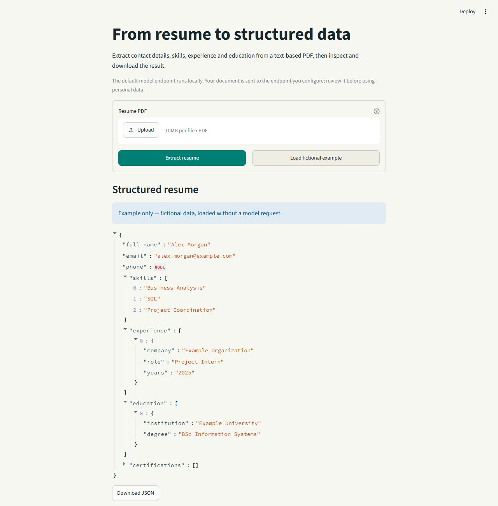

# LLM Resume Parser

**From a PDF resume to inspectable, structured data.**

A Streamlit application that extracts text from a resume, requests structured information from an OpenAI-compatible model endpoint, and validates the response before displaying JSON. The default endpoint is a local LM Studio server.



*Fictional example, loaded in the actual application without a model request.*

## What it returns

Contact information, skills, experience, education and certifications, with a JSON download. Missing scalar values are `null`; absent lists are empty, and absent experience is `null`. Invalid email/phone values become `null`. Schema validation checks structure, not factual accuracy: review the output against the resume.

## Quick start

Python 3.10 or later:

```sh
python -m venv .venv
# Windows: .venv\Scripts\Activate.ps1
source .venv/bin/activate
pip install -r requirements.txt
cp .env.example .env
streamlit run app.py
```

In LM Studio, load a model and start its OpenAI-compatible server. Set `RESUME_PARSER_MODEL` to the identifier exposed by that server. The default base URL is `http://localhost:1234/v1`. Configure another endpoint through `.env` or environment variables if needed.

Choose a text-based PDF and select **Extract resume**. To inspect the interface without installing a model, select **Load fictional example**.

## Boundaries

- Maximum PDF size: 10 MB; maximum length: 50 pages / 60,000 extracted characters.
- Password-protected and image-only PDFs are not supported; scanned files require OCR elsewhere.
- Malformed model responses and unavailable servers produce actionable messages.
- Resume text is sent to the endpoint you configure. Local hosting is the default, not a blanket privacy guarantee.
- This tool extracts information; it does not rank applicants or make hiring decisions.

## Test and extend

```sh
pip install -r requirements-dev.txt
python -m pytest -q
```

Tests use fictional fixtures and mocked model responses, without API charges or personal resumes. `resume_parser.py` owns extraction and validation; `app.py` owns the interface. The versioned example is in [`examples/resume.json`](examples/resume.json).

[License](LICENSE) · [Moayad Alshehry](https://github.com/MoayadAlshehry)
